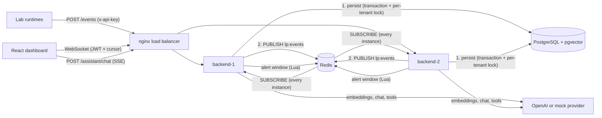
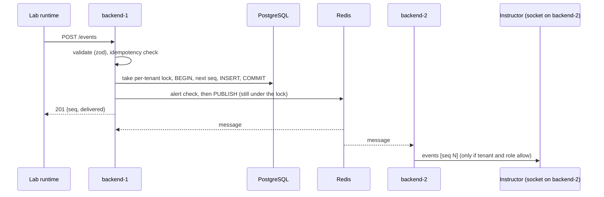

# LabPulse

A real-time lab event hub with an instructor dashboard and an AI lab assistant, built for the Spektra Round 2 technical assignment.

Hands-on lab runtimes post events (`lab.started`, `step.completed`, `lab.error`, ...). LabPulse stores each event durably, pushes it to the right people in real time across several backend instances, raises an alert when a learner keeps failing, and gives learners an assistant that answers from the lab guide and can look at their own recent errors.

- [Quick start](#quick-start)
- [Requirements coverage](#requirements-coverage)
- [Architecture](#architecture)
- [API and protocol reference](#api-and-protocol-reference)
- [The AI assistant](#the-ai-assistant)
- [Configuration](#configuration)
- [Testing and verification](#testing-and-verification)
- [Results](#results)
- [Limitations](#known-limitations) and [What I would do with another week](#what-i-would-do-with-another-week)
- [Repository layout](#repository-layout) and [Troubleshooting](#troubleshooting)

Design rationale, failure modes and the 50,000-connection plan are in [`docs/DESIGN.md`](docs/DESIGN.md).

---

## Quick start

Prerequisite: Docker Desktop (Compose v2). Nothing else needs installing: everything builds and runs in containers.

```bash
git clone <this repository> && cd LabPulse
docker compose up --build
```

The first build takes a few minutes. When it settles, six services are running:

| Service | Role | Port |
|---|---|---|
| `postgres` | PostgreSQL 16 + pgvector: events and lab-guide embeddings | 5432 (localhost only) |
| `redis` | Pub/Sub fan-out between backends, alert counters | 6379 (localhost only) |
| `init` | One-shot: creates the schema and embeds the lab guide, then exits | - |
| `backend1`, `backend2` | Two identical Node.js/TypeScript API + WebSocket instances | internal |
| `lb` | nginx load balancer in front of both backends | **8080** |
| `frontend` | React dashboard served by nginx (proxies `/api` and `/socket.io` to `lb`) | **5173** |

**Open http://localhost:5173**, pick a preset (for example *Acme - Instructor*) and sign in. The header shows the tenant name from the token, the live connection state and which backend instance your socket landed on.

### Generate some activity

```bash
# a single event
curl -X POST localhost:8080/events -H 'content-type: application/json' -H 'x-api-key: dev-ingest-key' -d '{
  "type": "lab.error", "tenantId": "acme", "labId": "lab-bicep-basics", "learnerId": "learner-1",
  "step": "Deploy the Bicep file", "message": "InvalidTemplate: storage account name too long",
  "occurredAt": "2026-11-22T10:00:00Z", "idempotencyKey": "demo-0001" }'

# or a continuous simulation for both demo tenants (needs Node 20+ on the host)
cd backend && npm install && npm run simulate
```

### Things to try

1. **Isolation.** Sign in as *Acme - Instructor* in one window and *Globex - Instructor* in another: each sees only its own learners. Sign in as *Acme - Learner 1*: only that learner's row, no alerts panel.
2. **Alert.** Send three `lab.error` events for one learner within two minutes: one alert appears in the feed and the bell badge counts it.
3. **Reconnect and catch-up.** Click **Simulate drop**, send a few events while it shows *Reconnecting*, and watch them arrive in order with no duplicates.
4. **Assistant.** Click a starter question, or ask your own. As a learner with some errors, ask *"Why did my deployment step fail?"* and the answer will say it used your lab events. Ask something unrelated (*"What is the capital of France?"*) and it replies *"That is not covered in the lab guide."*

### Enabling OpenAI

Without a key the app runs on an **offline mock provider** (deterministic, extractive answers) so everything works out of the box. To use OpenAI:

```bash
cp .env.example .env          # then set OPENAI_API_KEY=sk-...
docker compose up -d --build  # the init job notices the new embedding model and re-embeds the guide
docker compose logs init | tail -3      # should print: embeddings=openai:text-embedding-3-small
```

To try the larger embedding model without a schema change, set `OPENAI_EMBEDDING_MODEL=text-embedding-3-large` and `OPENAI_EMBEDDING_DIMENSIONS=1536`, then rebuild as above.

To stop: `docker compose down` (keeps data) or `docker compose down -v` (also wipes the database).

---

## Requirements coverage

| Req | Requirement | Where it lives |
|---|---|---|
| **A1** | `POST /events`: five event types, strict validation, useful errors | `backend/src/events/schema.ts`, `http/app.ts` |
| **A2** | Persist to PostgreSQL first, then WebSockets; Redis Pub/Sub across 2+ instances | `events/ingest.ts`, `realtime/hub.ts`, `docker-compose.yml` |
| **A3** | JWT carries `tenantId` and `role`; tenant isolation; learners see only their own events | `events/store.ts` (`canSee`, SQL filters), `realtime/hub.ts` |
| **A4** | At-least-once, idempotent; cursor catch-up, in order, no duplicates | `realtime/hub.ts`, `events/store.ts` |
| **A5** | Alert on 3+ `lab.error` in 2 min, exactly once per episode across instances (stretch) | `events/alerts.ts` (Redis Lua) |
| **A6** | Load script, throughput, p95 latency, what degrades first (stretch) | `backend/scripts/loadtest.ts`, [Results](#results) |
| **B** | Live grid per lab, alerts feed + unread badge, connection indicator, reconnect with catch-up, render by sequence, lab filter, tenant name from token | `frontend/src/` |
| **C1** | Ingest a Microsoft Learn module: chunk, embed, store in pgvector | `assistant/chunker.ts`, `guide.ts`, `data/lab-guide.md` |
| **C2** | Streamed answers with section citations; refuses when retrieval is weak | `assistant/orchestrator.ts` |
| **C3** | Tool routing for failure questions; tenant-safe; event text treated as untrusted | `assistant/tools.ts`, `orchestrator.ts` |
| **C4** | Ten Q&A pairs; retrieval hit rate and groundedness script (stretch) | `backend/eval/qa.json`, `scripts/eval.ts` |

Deliverables: this repository with a one-command `docker compose up`; this README; the design note [`docs/DESIGN.md`](docs/DESIGN.md); automated tests proving isolation, catch-up without duplicates and the alert rule ([Testing](#testing-and-verification));

---

## Architecture



### Write path: persist first, then announce



Key properties:

- **Durability before delivery.** An event is committed before anyone is told about it, so a crash never produces a notification for an event that does not exist.
- **Per-tenant sequence.** Each event gets the next gap-free number for its tenant, assigned under a per-tenant lock, so seq order equals commit order equals publish order. That number is the client's cursor.
- **Any instance can serve any client.** A browser's socket lives on one backend, but the POST may land on the other. Every instance subscribes to the Redis channel and delivers to its own sockets, filtered by the token's tenant and role.

### Read path: connect, catch up, go live

1. The client connects with `{ token, cursor }` (cursor omitted on first connect). The JWT is verified in the Socket.IO handshake.
2. The server registers the socket for live events *first* (buffering them), then reads Postgres from the cursor in batches and streams them in order.
3. It then drains the buffer and switches to live delivery in one synchronous step. A per-socket `lastSent` watermark drops duplicates and enforces order.
4. If an event was committed but never announced (publish failure or crash), the next event for that tenant exposes the sequence gap, or a 10-second sweep notices the database is ahead; affected sockets are re-synced from Postgres.
5. The dashboard keeps a log sorted by `seq` and derives its view from it, so even out-of-order or repeated delivery cannot corrupt what is shown.

### Data model

| Table | Purpose |
|---|---|
| `events` | `(tenant_id, seq)` primary key; type, lab, learner, step, message, `occurred_at`; unique `(tenant_id, idempotency_key)` with a payload hash for conflict detection. Alerts are stored here too (`type = instructor.alert`). |
| `tenant_seq` | One counter row per tenant (the sequence source). |
| `guide_chunks` | Lab-guide chunks with `vector(1536)` embeddings and the embedding model that produced them. |

### Tenant isolation

Isolation is enforced in one place, `canSee()` in `events/store.ts`, and mirrored in the SQL used for replay: an event is visible only if its tenant matches the token; instructors see every event of their tenant; learners see only events where `learner_id` equals their token's subject, and never alerts. The tenant and learner identity always come from the verified JWT, never from request bodies or from the AI model.

---

## API and protocol reference

### `POST /events`

Header `x-api-key: <INGEST_API_KEY>`. Body (all fields required, unknown fields rejected):

| Field | Rules |
|---|---|
| `type` | `lab.started` \| `step.completed` \| `lab.error` \| `lab.timeout` \| `lab.completed` |
| `tenantId`, `labId`, `learnerId` | 1-128 chars of `A-Za-z0-9_.:-@` |
| `step` | 1-200 chars |
| `message` | up to 2000 chars (may be empty) |
| `occurredAt` | ISO-8601 timestamp, at most 24 h in the future |
| `idempotencyKey` | 8-200 chars; must not start with `alert:` (reserved) |

| Status | Meaning |
|---|---|
| `201` | Accepted: `{ status: "accepted", seq, delivered, alert?, instance }`. `delivered: false` means it was saved but the real-time announcement failed; clients recover automatically. |
| `200` | Duplicate of an earlier request with the same key and payload: returns the original `seq` and creates nothing. |
| `400` | `validation_error` with `details: [{ path, message }]`, or `invalid_json`. |
| `401` | Missing or wrong `x-api-key`. |
| `409` | `idempotency_conflict`: the key was used before with a different payload. |
| `503` | `unavailable` (database timeout) or `tenant_busy` (write queue full), with `Retry-After`. Retrying with the same key is safe. |

### WebSocket (Socket.IO, websocket transport only)

Connect to the same origin (path `/socket.io`) with `auth: { token, cursor? }`.

| Direction | Event | Payload |
|---|---|---|
| server to client | `hello` | `{ instance, tenantId, tenantName, role }` |
| server to client | `events` | `StoredEvent[]`, strictly ascending `seq` (the canonical stream: replay and live) |
| server to client | `instructor.alert` | one alert `StoredEvent`, instructors only (also present in `events`) |
| server to client | `caught_up` | `{ cursor }`, sent when replay is finished |

`StoredEvent`: `{ tenantId, seq, type, labId, learnerId, step, message, occurredAt, idempotencyKey }`. A bad token is rejected with `connect_error: unauthorized`; a socket is closed when its token expires.

### Other endpoints

| Endpoint | Notes |
|---|---|
| `GET /health` | `{ status: ok \| degraded \| down, instance, db, redis, sockets }` |
| `POST /dev/token` | Demo only (`DEV_AUTH=true`): `{ tenantId, tenantName?, role, userId }` returns a signed JWT. |
| `POST /assistant/chat` | `Authorization: Bearer <jwt>`, body `{ question }` (1-1000 chars). Server-sent events: `meta` (`confidence`, `citations[{n, section, score}]`), `tool`, `delta` (`text`), `done` (`cited[]`, `toolsCalled[]`, `grounded`), `error` (`code`, `message`). |

JWT claims: `sub` (user id; for learners this is the `learnerId`), `tenantId`, `tenantName` (optional), `role`, `exp`.

---

## The AI assistant

Retrieval-augmented generation over a real Microsoft Learn module, *Build your first Bicep template* (`data/lab-guide.md`).

1. **Ingest** (the `init` job). The guide is split along its headings into chunks of at most about 1,400 characters, each labelled with its section (for example *"Add flexibility by using parameters and variables > Resource names"*). Chunks are embedded in batches and stored in `guide_chunks` (pgvector). Re-running is idempotent and re-embeds automatically if the embedding model changes.
2. **Question.** On OpenAI a cheap call first fixes spelling, so typos do not defeat retrieval. The question is embedded and the four nearest chunks are fetched by cosine similarity.
3. **Confidence gate.** If the best similarity is below the threshold (`RETRIEVAL_MIN_CONFIDENCE`, default 0.25 on OpenAI), the reply is exactly *"That is not covered in the lab guide."* and no model is called.
4. **Generate.** Otherwise the excerpts go into the prompt with rules to answer only from them and to cite as `[n]`; the answer streams back and the UI shows the cited sections.
5. **Tool routing.** For failure questions from a learner (*fail, error, broke, stuck...*), the model is given `get_my_recent_errors` (and required to call it). The tool reads that learner's latest `lab.error` events from Part A's database and the model combines them with the guide excerpts.

**Safety.** The tool takes no identity arguments: tenant and learner come only from the verified token, and instructors are refused. Event text is attacker-influenced (a lab runtime wrote it), so before it reaches the prompt it is stripped of control characters, `<` and `>` are escaped, it is length-capped, JSON-encoded and fenced in `<untrusted_lab_events>` tags, and the system prompt states it is data and not instructions. An LLM timeout ends the stream with a typed `error` event.

**Provider seam.** `LLMProvider` (`assistant/llm.ts`) hides the vendor. Two implementations ship: OpenAI, and an offline mock that is deterministic and extractive but exercises the same retrieval, streaming, citation and tool-calling code. Everything in the test suite runs against the mock or a fake OpenAI server, so no API key is needed to run the tests.

**Evaluation.** `backend/eval/qa.json` holds ten in-scope question/answer pairs (each names a phrase the right chunk must contain), three out-of-scope questions that must be refused, and one failure question that must trigger the tool while an injected event message must not leak the system prompt. `npm run eval` reports retrieval hit rate@4, a groundedness check (a valid citation plus at least 70% of the answer's content words present in the retrieved text) and the refusal rate.

---

## Configuration

Copy `.env.example` to `.env`; everything is optional for a local demo. The backend also reads these (defaults in `backend/src/config.ts`):

| Variable | Default | Purpose |
|---|---|---|
| `OPENAI_API_KEY` | empty | Enables the OpenAI provider (otherwise the mock is used) |
| `LLM_PROVIDER` | `openai` if a key is set, else `mock` | Force a provider |
| `OPENAI_CHAT_MODEL` | `gpt-4o-mini` | Answer and spell-fix model |
| `OPENAI_EMBEDDING_MODEL` / `OPENAI_EMBEDDING_DIMENSIONS` | `text-embedding-3-small` / unset | Embedding model; dimensions must stay 1536 |
| `RETRIEVAL_MIN_CONFIDENCE` | 0.25 (OpenAI), 0.18 (mock) | Refusal threshold |
| `LLM_TIMEOUT_MS` | 20000 | Whole-request deadline for the assistant |
| `JWT_SECRET`, `INGEST_API_KEY` | development defaults | **Change for anything but a local demo** |
| `DEV_AUTH` | `true` | Enables `POST /dev/token`; set `false` outside demos |
| `ALERT_THRESHOLD`, `ALERT_WINDOW_MS` | 3, 120000 | The alert rule |
| `PG_POOL_MAX`, `PG_QUERY_TIMEOUT_MS` | 20, 5000 | Connection pool size and client-side query timeout |
| `HUB_SWEEP_MS`, `REPLAY_BATCH` | 10000, 500 | Lost-announcement sweep interval; catch-up page size |

The backend logs a security warning at start-up for each development default still in use.

---

## Testing and verification

### Automated tests

```bash
docker compose up -d postgres redis     # the tests use real Postgres and Redis
cd backend  && npm install && npm test   # 49 tests, two real server instances in-process
cd frontend && npm install && npm test   # 6 tests
```

| File | Proves |
|---|---|
| `isolation.test.ts` | No cross-tenant delivery on either instance; learners get only their own events, live and on replay; learners never get alerts; forged and expired tokens rejected; a client cannot widen scope through the handshake. |
| `catchup.test.ts` | Replay through the *other* instance is complete and in order; a 60-event burst arriving *during* replay produces no gaps or duplicates; first-connect snapshot then live. |
| `alerts.test.ts` | Exactly one alert from concurrent errors on both instances; delivered as `instructor.alert` to instructors only; sliding window and episode re-arming with an injected clock; duplicate POSTs not double counted. |
| `ingest.test.ts` | Field-level validation errors, idempotency (`200` / `409`), ten concurrent identical POSTs create one row, gap-free sequence under concurrency. |
| `hardening.test.ts` | A committed-but-never-announced event is still delivered in order (gap detection, sweep, learner-scoped); malformed Redis messages ignored; a quiet tenant keeps its latency while another floods; alert claim release; reserved key namespace; sockets close at JWT expiry. |
| `assistant.test.ts`, `openai.test.ts` | Citations, refusal, tool isolation, identity from the token, prompt-injection neutralisation, typo tolerance; the OpenAI adapter against a fake OpenAI-compatible server (batched embeddings, streaming, fragmented tool calls). |
| `frontend/src/lib/store.test.ts` | Reversed and randomly shuffled delivery, with duplicates, converges to the same view. |

I checked that the tests actually bite by mutating the code (removing the tenant filter, the duplicate guard, the alert claim, gap detection, the per-tenant queue) and confirming the right tests fail.

### End-to-end checks against the running stack (`verify/`)

With the stack up: `cd verify && npm install`, then (needs Google Chrome for the browser suites):

| Script | What it does | Checks |
|---|---|---|
| `npm run browser` | Headless Chrome through the whole UI: tenant name, live grid, alert + badge, lab filter, drop and catch-up with no duplicates, isolation, learner view, assistant citation, refusal and tool use | 20 |
| `npm run ui` | Starter questions are guide-related, chat auto-scrolls, messages never overlap, the panel fills the screen (and does not collapse on a narrow one) | 14 |
| `npm run probes` | A noisy tenant does not slow a quiet one; a committed-but-unannounced event still reaches a live client | 3 |
| `npm run fault:redis` | Stops Redis mid-session: POSTs still succeed, `/health` degrades, the client receives every missed event in order after recovery | 11 |
| `npm run fault:pg` | Freezes Postgres: POST fails with `503 + Retry-After` in about 5 s, same-key retry succeeds without a duplicate | 6 |

These scripts use throwaway tenants. I also ran the whole battery against a clean copy of the repository (no `.env`, `node_modules` or build output) built as a separate Compose project, which surfaced and led me to fix two real defects described in the design note: a lost announcement that clients never recovered, and a noisy-neighbour starvation of the connection pool.

---

## Results

Measured on a laptop with Docker Desktop, with the load generator on the same machine, so treat them as indicative, not as a benchmark.

**A6, paced: 1,000 events over 30 s, 3 tenants, through the load balancer**

| Accepted | Delivered to sockets | Lost | POST ack p50 / p95 / p99 | End-to-end p50 / p95 / p99 |
|---|---|---|---|---|
| 1000 / 1000 | 1000 / 1000 | 0 | 9 / 18 / 42 ms | 9 / **17** / 41 ms |

End-to-end latency is from sending the POST to the instructor socket receiving the event. An earlier run had one roughly 0.5 s stall (p99 about 500 ms) that I did not investigate and that did not recur.

**Burst: as fast as possible, 200 concurrent POSTs**

| Scenario | Throughput | Ack p95 | Lost |
|---|---|---|---|
| 6,000 events, 3 tenants | about 470 events/s | about 830 ms | 0 |
| 3,000 events, 1 hot tenant | about 400 events/s | about 700 ms | 0 |

Throughput varied noticeably between runs (earlier runs reached about 730 and 530 events/s).

**What degrades first:** POST acknowledgement latency, not delivery. Every write does a Postgres commit and a Redis publish inside the per-tenant lock, so latency grows with queue depth while sockets never fall behind and nothing is lost. A single hot tenant is capped by that serial section, which is the price of strict per-tenant ordering. Other tenants are unaffected: a quiet tenant stays around 8 ms p50 during another tenant's flood. The next limits would be the connection pool, then Postgres commit throughput.

**C4, assistant evaluation (offline mock provider):** retrieval hit rate@4 **9/10**, groundedness **10/10**, out-of-scope refusals **3/3**, tool called for the failure question, injected text did not leak the system prompt. These exercise retrieval and orchestration, not model quality: the mock is extractive, and its refusal threshold was tuned on this small set. Re-run with a key via `npm run eval` (see the printed top scores to re-tune `RETRIEVAL_MIN_CONFIDENCE`).

---

## Known limitations

- **A real OpenAI call has not been made.** The adapter is tested against a fake OpenAI-compatible server; answer quality and the 0.25 default threshold still need a run with a real key.
- **Alerts fail open.** If Redis is down, events are still saved and delivered later, but an alert whose three errors all happened during the outage is not raised afterwards.
- **A lost announcement is repaired, not prevented**: within the next event or one 10-second sweep, not instantly (an outbox relay would be immediate).
- **Assistant:** retrieval uses the learner's question only (error text is not yet used to search the guide); failure intent is detected with a keyword list; there is no conversation memory.
- **Auth is demo-grade.** `/dev/token` mints tokens for any tenant, ingest uses one shared key, there is no rate limiting and no early token revocation. The shipped defaults are for local use only (the backend warns at start-up).
- **Dashboard** keeps all received events in memory and replays at most the latest 5,000 events on a first connection; the "read" state of alerts is not persisted across page reloads.
- **nginx resolves the backend names at start-up**; if a backend container is recreated onto a different IP, run `docker compose restart lb`.
- Browser checks run on Chrome only, at a couple of viewport sizes.

## What I would do with another week

1. **Better retrieval:** search the guide with the error text as well as the question, hybrid keyword + vector search, re-ranking, conversation memory, and let the model decide when to call the tool. First, a 30+ question evaluation set (paraphrases, typos, follow-ups) with an LLM judge so each change is measured.
2. **Delivery guarantees:** a transactional outbox with a relay so announcements are retried immediately; rebuild alert windows from Postgres after a Redis outage; fault injection under sustained load.
3. **Scale:** shard the Pub/Sub channel by tenant, index sockets by learner, and move hot tenants to a partitioned log (see the 50,000-connection plan in the design note).
4. **Security:** OIDC login, per-tenant ingest keys, rate limits, token refresh and revocation on live sockets, secrets from a vault.
5. **Frontend:** virtualised grid, a server-side snapshot instead of replaying a 5,000-event tail, persisted alert read-state, Playwright in CI.
6. **Operations:** metrics and tracing (publish lag, sweep repairs, catch-up duration, socket backlog), dashboards and alerts, dynamic upstream resolution in the load balancer.

---

## Repository layout

```
docker-compose.yml        the whole stack
nginx/lb.conf             load balancer config
data/lab-guide.md         the Microsoft Learn module used for RAG
backend/
  src/events/             validation, persistence (store), ingest pipeline, alert detector
  src/realtime/hub.ts     Redis subscription, per-socket catch-up, gap detection
  src/assistant/          chunker, retrieval, orchestrator, tools, OpenAI and mock providers
  src/http/app.ts         REST endpoints; createServer.ts / server.ts wiring
  scripts/                init, loadtest, simulate, eval
  test/                   integration tests (real Postgres + Redis)
  eval/qa.json            the evaluation questions
frontend/src/             React dashboard (lib/store.ts is the sequence-ordered view model)
verify/                   end-to-end browser and fault-injection scripts
docs/                     DESIGN.md (design note), DEMO.md (demo guide)
```

## Troubleshooting

| Symptom | Fix |
|---|---|
| `Cannot connect to the Docker daemon` | Start Docker Desktop and retry. |
| Port 5432, 6379, 8080 or 5173 already in use | Stop the other service (or change the host port in `docker-compose.yml`). |
| Assistant answers look crude | You are on the mock provider. Set `OPENAI_API_KEY` in `.env` and run `docker compose up -d --build`; confirm with `docker compose logs init`. |
| Assistant always says "not covered" after adding a key | The guide was not re-embedded: `docker compose run --rm init node dist/scripts/init.js --force`. |
| Dashboard empty | No events yet: run `npm run simulate` or the `curl` example above. |
| 502/504 after recreating a backend | `docker compose restart lb`. |
| Start over | `docker compose down -v && docker compose up --build`. |

## Attribution

`data/lab-guide.md` is assembled from the Microsoft Learn module *Build your first Bicep template* ([MicrosoftDocs/learn](https://github.com/MicrosoftDocs/learn), licensed CC BY 4.0), used here only as sample lab content.
